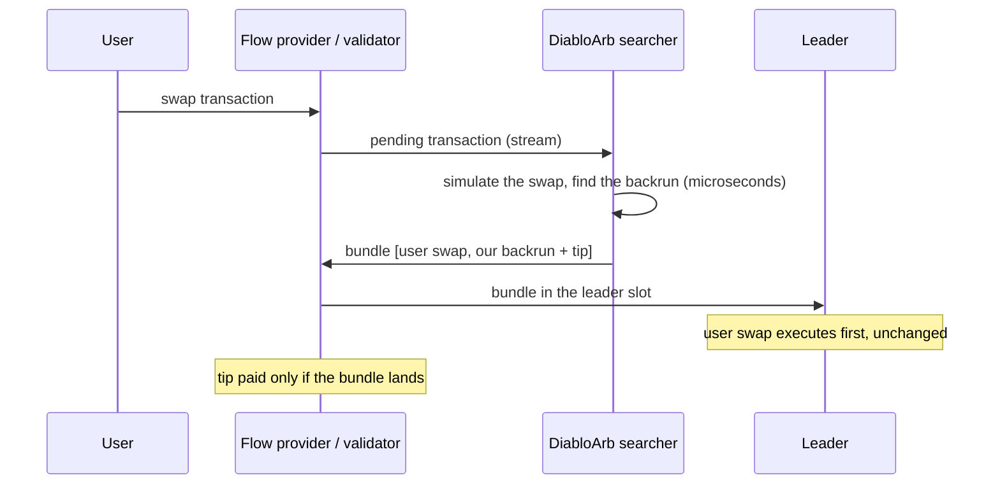

# DiabloArb — Solana backrun searcher

We run a low-latency **backrun arbitrage searcher** on Solana. When a swap moves a pool's price away from the rest of
the market, we close the gap with a cyclic arbitrage placed **right behind that swap** — never in front of it.

We are looking for **validators and order-flow providers** who want a reliable, revenue-sharing searcher on their flow.

## How it works

1. We receive pending transactions (from flow providers and the network) and simulate each swap's effect on the pools
   it touches — over 200,000 pools across 15 DEX programs: Pump AMM, Meteora DLMM / DAMM v1 / DAMM v2 / DBC, Raydium
   AMM v4 / CPMM / CLMM, Orca Whirlpool and more.
2. If the swap leaves a price gap between pools, we build a 2–4 hop cycle that closes it and send it as a bundle:
   **your transaction first, ours right after it**.
3. Our on-chain executor checks the profit inside the transaction. If the price has already moved, our transaction
   reverts and the bundle does not land — no partial fills, no cost to anyone else.

## What we never do

- **No sandwiches, no front-running.** Our transaction always goes after the user's swap. The user's price is untouched.
- We do not resell or forward your order flow. It is used only to backrun, inside your bundle.

## Why it is good for you

- **Revenue.** A share of every captured opportunity is paid as a tip to your account inside the same bundle — only
  when it lands. The share is negotiable.
- **Better prices for your users.** Backruns pull pools back to the market price right after large swaps.
- **Transparent.** Everything is on-chain; we share per-bundle statistics with partners.

## In numbers (November 2026)

- **Flow processed:** ~3 million pending transactions a day from one flow partner and ~1 million from another, on top
  of the network's own stream.
- **Speed:** the backrun search takes ~90 µs on median after a swap arrives; the bundle is built in under a millisecond.
- **Reach:** 6 nodes in Europe, North America and Asia; bundle lanes through Jito, Astralane, ZeroCopy and partners'
  own validator lanes.
- **Partner blocks pay off:** in our partner's validator slots we capture about **twice** as often as in other blocks.

## How to integrate

What we already support:

- pending-transaction streams (relayer-style packet batches, searcher gRPC with auctions);
- bundles to a partner endpoint for your validators' leader slots (`sendBundle`-style), to the Jito block engine, and
  first-price auctions with a minimum tip share.

What we need from you:

1. a stream of pending transactions and the leader schedule of your validators;
2. a bundle endpoint for your validators' slots;
3. a status per bundle — delivered to the leader, landed, or dropped and why;
4. your transaction and our backrun treated as one unit, in one auction.

## Contact

info@diablo.bot
