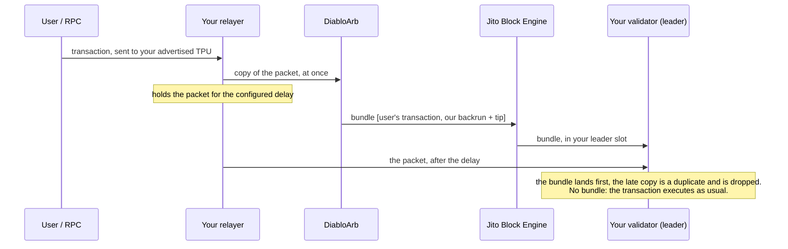

# Validator integration guide

How a Solana validator connects to the DiabloArb backrun searcher. Written for operators who have not done this
before, and for the AI assistants they ask for help: every step names the exact flag or config key, how to verify it
and how to undo it.

- Version: 13 November 2026.
- Checked against the sources of jito-solana `v4.4.1-jito`, Agave `v4.4.1`, Firedancer `main` and Harmonic's
  documentation on 13 November 2026. If your version is different, compare each flag with `agave-validator --help`
  (or your `default.toml`) before you run it.
- Contact: info@diabloarb.com. Addresses, ports and our public keys are sent to you privately; in this guide they are
  written as `<PLACEHOLDERS>`. We never ask for any key of yours.

## Quick start

```bash
git clone https://github.com/cryptodiablo/diabloarb-searcher && cd diabloarb-searcher/validators
bash scripts/detect-setup.sh            # on the validator host: what you run and which path fits
```

Send us the summary line it prints at the end (your validator's public key and setup, nothing secret). We will reply
with the path that fits you, what to set up and the terms. Then follow the path for your setup; each script below is
a dry run until you add `--apply`, and prints how to undo what it did.

| Script | Path | What it does |
|---|---|---|
| `scripts/detect-setup.sh` | all | Reads the running processes, their config and the gossip table. Changes nothing |
| `scripts/shred-mirror.sh --add <IP:PORT>` | A | Adds our receiver to your leader shred list, keeping every address already there |
| `scripts/staked-overrides.sh --add <PUBKEY>=<LAMPORTS>` | B | Merges our sender keys into your overrides file and loads it |
| `scripts/relayer-switch.sh --endpoint <URL>` | C1 | Points your existing relayer at us through a systemd drop-in |
| `scripts/relayer-install.sh …` | C2 | Installs a relayer (testnet first) |
| `scripts/verify.sh shreds\|relayer\|tpu` | all | Checks after each step |

The scripts need `bash`, `curl`, `jq` and, for checks, `tcpdump`. They never read, print or send a private key. Their
tests run on fake processes and files: `bash tests/run.sh`. `relayer-switch.sh` and `relayer-install.sh` are checked
only for their arguments there; their first real run is part of the testnet trial with us.

## 1. What we do

We run a backrun arbitrage searcher. When a swap moves a pool's price away from the rest of the market, we close the
gap with one atomic transaction placed **after** that swap.

- No sandwiches and no front-running: nothing of ours is placed before a user's transaction.
- We do not modify, re-sign or resell what you send us.
- Our transaction checks its profit on chain. If the gap is gone, it reverts and, inside a bundle, the bundle does not
  land.

Every transaction we land in your slots is on chain, signed by wallets we disclose to you.

## 2. Find your setup

How users' transactions reach your validator decides what you can share. Look at how your validator is started:

| If your start script or config has… | Your setup |
|---|---|
| `--bam-url`, or `[tiles.bam] enabled = true` | **BAM** (Jito's block assembly) |
| `harmonic-scheduler` with `--remote-tpu-url`, or `[tiles.bundle] tpu_url = "…harmonic.gg"` | **Harmonic** (Salsa or Samba) |
| `--relayer-url` | **Jito with a relayer** |
| `--block-engine-url`, none of the above | **Jito without a relayer** |
| Firedancer, no BAM, no Harmonic | **Firedancer** |
| none of the above | **Agave** |

How the network looks today. Shares of active stake by the client each validator announces in gossip, 13 November
2026, 699 vote accounts, 432 million SOL. "Relayer" is our estimate: the validator's TPU is on the relayer's default
port 11228 or on another machine.

| Setup | Share of stake | Validators | Where users' transactions arrive |
|---|---|---|---|
| BAM (AgaveBam, FireBAM) | 38.8 % | 378 | at a Jito BAM node: 16 shared addresses, port 5010 |
| Harmonic (Agave and Firedancer based) | 30.7 % | 88 | at Harmonic's Remote TPU: 7 shared addresses |
| Jito without a relayer | 16.2 % | 100 | at the validator itself |
| Jito with a relayer | about 6 % | 36 | at the relayer |
| Firedancer (no BAM, no Harmonic) | 5.6 % | 36 | at the validator itself (4 of 36 behind a proxy) |
| Rakurai | 1.3 % | 8 | at the validator itself |
| Agave | 1.0 % | 18 | at the validator itself |
| Other | about 0.4 % | 7 | — |

## 3. What works for your setup

There are three ways to work together. They can be combined.

- **A. Leader shred mirror.** You copy the shreds you already broadcast as leader to one more address, ours. We see your
  block as you produce it and send our backrun to you. Nothing leaves your node before execution.
- **B. Staked connection for our sender.** Your validator gives our sender's identity priority on its own TPU. You
  share nothing.
- **C. Pending-transaction stream.** Transactions on their way to your validator are copied to us before execution. We
  return a bundle: the user's transaction, then our backrun with your tip.

| Setup | A | B | C | Who holds the pending flow |
|---|---|---|---|---|
| BAM | yes | no: users send to the BAM node, not to you | no | Jito, inside the BAM node |
| Harmonic | yes, if your client takes a second shred address (section 5) | no: users send to Harmonic's Remote TPU | no | Harmonic |
| Jito with a relayer | yes | yes, on the relayer | **yes, easiest**: point your relayer at us (section 6.1) | you |
| Jito without a relayer | yes | yes | yes, by adding a relayer: testnet trial with us first (section 6.2) | you |
| Firedancer | yes | ask us | no relay support in Firedancer | you |
| Rakurai | ask us | yes (Agave based) | ask us | you |
| Agave | no flag for it in Agave `v4.4.1` | yes | no relay support in Agave | you |

What each path is worth to you. With **C** our backrun travels in one bundle with the user's transaction and pays a
tip to you only when it lands; this is where most of the revenue is. With **A** and **B** we learn about a transaction
only after you executed it, so our backrun lands later in the same slot or in your next one. It pays less often than
C, costs you nothing and has no effect on your users.

If you run BAM or Harmonic and want to sell your flow, the flow is not on your machine: users send it to Jito's or
Harmonic's servers. That conversation is with them; we are happy to join it.

**Does it slow you down?** Paths A and B add no delay to your users' transactions. Path C uses a relayer that holds
each transaction for a short delay before it reaches your validator (50 ms by default). If you already run a relayer,
that delay is already there and pointing it at us adds nothing; if you add one, you choose the delay together with us
and test it on testnet first.

**Bundles.** Only path C uses bundles: the user's transaction first, our backrun second, with the tip inside; the
bundle lands whole or not at all. With A and B the user's transaction has already executed when we see it, so we send
only our own transaction, and it can only land after it.

## 4. Before you start

Send us (none of this is secret):

1. your validator identity public key(s), and vote account(s) if you want reports per validator;
2. client and version (`agave-validator --version`, or the Firedancer version) and your setup from section 2;
3. the data centre or city of the node, and the public IP of the relayer if you have one;
4. which path you want to start with.

We send you:

1. for A: a receiver address `<SHRED_RECEIVER_IP>:<PORT>` near your node;
2. for B: our sender identity public keys `<SENDER_PUBKEY_n>`, one per region;
3. for C: the endpoint `<FLOW_ENDPOINT>` and the IPs to allow;
4. the wallets our backruns are signed by, so that you can audit them on chain.

## 5. Path A: leader shred mirror

**What leaves your node.** Only the shreds of blocks you produce, the same bytes you broadcast to everyone. No pending
transactions, no keys, no logs. Traffic: a few megabytes per leader slot, UDP, outbound.

### Agave based clients: jito-solana, BAM (AgaveBam), Harmonic Salsa, Rakurai

The flag is `--shred-receiver-address`. In jito-solana `v4.4.1-jito` the validator will "mirror this validator's own
broadcast shreds to these addresses in addition to normal turbine operation"; it takes several addresses,
comma-separated or repeated, up to 32.

Harmonic already uses this flag for its own receiver, and BAM setups may use it too. **Keep every address that is
there and add ours.** Before you start, check that your binary takes more than one address:

```bash
agave-validator --help | grep -A6 -- '--shred-receiver-address'
```

If the help text does not mention several addresses, stop and write to us: replacing Harmonic's or Jito's receiver
would break your setup.

**With the script** (it does the check above, keeps your addresses and prints the start-script flag):

```bash
bash scripts/shred-mirror.sh --add <SHRED_RECEIVER_IP>:<PORT>           # dry run: shows the old and new list
bash scripts/shred-mirror.sh --add <SHRED_RECEIVER_IP>:<PORT> --apply   # applies at run time, no restart
bash scripts/verify.sh shreds --to <SHRED_RECEIVER_IP>:<PORT>           # waits for your next leader slot
```

If you changed the list at run time since the validator started, pass it with `--existing "<LIST>"`: the script
otherwise reads the list from the validator's command line.

**By hand:**

1. Look at what you pass today:

   ```bash
   ps aux | grep -o -- '--shred-receiver-address [^ ]*'
   ```

2. Set the full list on the running validator (no restart):

   ```bash
   agave-validator -l /path/to/ledger set-shred-receiver-address \
     --shred-receiver-address <EXISTING_ADDRESS_IF_ANY>,<SHRED_RECEIVER_IP>:<PORT>
   ```

   An explicit list replaces the previous one, including an address your block engine configured for you.

3. Make it permanent: put the same list in your start script.

4. Verify. During one of your leader slots (`solana leader-schedule | grep <YOUR_IDENTITY>`):

   ```bash
   sudo tcpdump -ni any -c 20 'udp and dst host <SHRED_RECEIVER_IP> and dst port <PORT>'
   ```

   You should see packets of about 1200 bytes while you are leader and none otherwise. We confirm from our side that
   they decode into your slots.

**Undo:** set the list as it was before, and restore the start script.

### Firedancer based clients: Firedancer, FireBAM, Harmonic Samba

```toml
[tiles.shred]
    additional_shred_destinations_leader = ["<EXISTING_ADDRESS_IF_ANY>", "<SHRED_RECEIVER_IP>:<PORT>"]
```

From Firedancer's `default.toml`: "Each shred that the validator produced when it is leader will be sent to the
addresses specified for leader." The list is read at start, so this needs a restart at a moment you choose, away from
your leader slots. Use numeric IPs. Harmonic Samba already has Harmonic's receiver in this list: keep it.
`bash scripts/shred-mirror.sh --add <SHRED_RECEIVER_IP>:<PORT>` prints the line with your current entries kept; it
does not edit `config.toml`. Verify with `scripts/verify.sh shreds` or the same `tcpdump` command.

**Undo:** remove our entry and restart.

### Vanilla Agave

Agave `v4.4.1` has no option to mirror shreds. Use path B.

## 6. Path C: pending-transaction stream

Only for Jito setups without BAM and without Harmonic. Read the whole section before deciding.

**How it works.**



- Users' transactions arrive at the relayer, which forwards each packet to your validator after a short delay and,
  immediately, a copy of the packets that touch the programs we ask for (DEX programs) to us.
- If the swap leaves an arbitrage, we send a Jito bundle: the user's transaction first, ours second. It reaches you
  through the block engine connection you already have. The tip goes through Jito's tip program, so it arrives as your
  usual MEV rewards and is shared with your stakers at your commission.
- If we send nothing, or our bundle does not land, the user's transaction executes exactly as it would have.

The protocol is Jito's relayer protocol (`jito-labs/mev-protos`: `auth.proto`, `block_engine.proto`). Our endpoint
plays the "block engine" of that protocol: the relayer logs in with its own keypair (challenge and signature),
receives the list of programs of interest and streams packets. We send back nothing but heartbeats. This is in
production with a flow partner today.

### 6.1 You already run a relayer

**With the script:**

```bash
bash scripts/relayer-switch.sh --endpoint <FLOW_ENDPOINT>           # dry run: current URL, login key, the change
sudo bash scripts/relayer-switch.sh --endpoint <FLOW_ENDPOINT> --apply
bash scripts/verify.sh relayer --unit <RELAYER_UNIT>
sudo bash scripts/relayer-switch.sh --revert --apply               # undo
```

It finds the relayer's systemd unit and writes a drop-in (`/etc/systemd/system/<unit>.d/diabloarb.conf`), so your
unit file stays as it is and removing the drop-in undoes the change. If the relayer is started by a wrapper script or
in a container, the script stops and tells you which line to change by hand.

**By hand:**

1. Find how the relayer is started (systemd unit or script) and its `--block-engine-url`.
2. Ask us before changing it: tell us what that URL is today. Jito retired relayers from its own setup in late 2025
   (jito-solana issue #1505), but we do not know what your current connection is used for.
3. Generate a keypair for the relayer's login to us if it has none of its own (`solana-keygen new -o relayer-auth.json`,
   never your identity or vote key) and send us its public key. Its path is `--keypair-path`.
4. Set `--block-engine-url <FLOW_ENDPOINT>` (and `--block-engine-auth-service-url <FLOW_ENDPOINT>` if your unit sets
   one) and restart the relayer. The validator stays on the relayer; if the relayer misses heartbeats, the validator
   falls back to its own TPU by itself (`--relayer-max-failed-heartbeats`, default 3 of 500 ms).
5. Verify: the relayer's log shows a successful authentication and a packet stream; we confirm packets from your
   relayer.

**Undo:** restore the previous `--block-engine-url` and restart the relayer.

### 6.2 You do not run a relayer

This means putting a relayer in front of your TPU. It is the only path that changes how transactions reach your
validator, so we do it together: testnet first.

**The state of the software, honestly.**

- The reference relayer is `jito-foundation/jito-relayer`. Its last release is `v0.4.2` (June 2025); the repository was
  archived in July 2026 and is unmaintained.
- The validator side still ships in jito-solana `v4.4.1-jito`: `--relayer-url`, the runtime command
  `set-relayer-config`, `--relayer-expected-heartbeat-interval-ms` (default 500) and `--relayer-max-failed-heartbeats`
  (default 3). An open issue (#1505) proposes removing them; after that, this path needs a different relay.
- A relayer built in 2025 predates the v1 transaction format: it passes such packets to your validator but may not
  recognise them as DEX transactions, so they would not be copied to us.
- We have not tested the archived relayer against a `v4.4.1-jito` validator.

The relayer settings that matter, from its source (`transaction-relayer/src/main.rs`):

| Flag | Meaning |
|---|---|
| `--block-engine-url` | Where packets are copied: `<FLOW_ENDPOINT>` |
| `--keypair-path` | A keypair made for the relayer only; send us its public key |
| `--signing-key-pem-path`, `--verifying-key-pem-path` | Keys for the tokens between relayer and validator |
| `--public-ip` | The address your validator will advertise as its TPU |
| `--tpu-quic-port` (11228), `--tpu-quic-fwd-port` (11229) | QUIC ports the relayer listens on; open them |
| `--grpc-bind-port` (11226) | Where your validator connects; keep it private |
| `--rpc-servers`, `--websocket-servers` | Your own RPC, for the leader schedule |
| `--allowed-validators` | Your identity key(s): nobody else may attach |
| `--packet-delay-ms` (50) | How long every packet waits before it reaches your validator |
| `--staked-nodes-overrides` | The relayer terminates QUIC, so stake-weighted QoS overrides move here |

**Trade-offs.** Every transaction to your validator waits `--packet-delay-ms`; start low and agree the number with us.
The relayer becomes part of your transaction ingestion: run it on the validator host or right next to it and test the
fallback.

**With the script.** `scripts/relayer-install.sh` downloads the `v0.4.2` release binary and checks its SHA-256
(`62a64239211e00821cd891505326820133873a3119f04c71504c2e4391b282da`), makes the relayer's own keys in
`/opt/diabloarb-relayer/keys` (an RSA pair for its tokens, a Solana keypair for its login to us), writes the systemd unit
from `templates/diabloarb-relayer.service` and starts it. It does not attach your validator: it prints that command.
On mainnet it refuses to run until you pass `--tested-on-testnet`.

```bash
bash scripts/relayer-install.sh --endpoint <FLOW_ENDPOINT> --identity <YOUR_IDENTITY> --public-ip <THIS_HOST_IP>          # dry run
sudo bash scripts/relayer-install.sh --endpoint <FLOW_ENDPOINT> --identity <YOUR_IDENTITY> --public-ip <THIS_HOST_IP> --apply
# then, away from your leader slots:
agave-validator -l /path/to/ledger set-relayer-config --relayer-url http://127.0.0.1:11226
bash scripts/verify.sh relayer && bash scripts/verify.sh tpu
```

Open UDP 11228–11229 to the internet; keep TCP 11226 reachable from this host only (the unit binds it to 127.0.0.1).

**Trial plan.**

1. Testnet validator, relayer next to it, `--block-engine-url` at our test endpoint. Confirm: the validator attaches,
   the advertised TPU changes, transactions land, we receive packets.
2. Stop the relayer; confirm the validator returns to its own TPU within about 1.5 seconds and keeps producing full
   blocks.
3. Mainnet on one validator, lowest delay that still lets bundles land, for a week. We send per-bundle statistics; you
   compare block rewards and skip rate with the week before.
4. Keep, tune or switch off: `agave-validator -l /path/to/ledger set-relayer-config --relayer-url ""` detaches the
   relayer at run time; remove `--relayer-url` from the start script to make it permanent.

## 7. Path B: staked connection for our sender

Only where users' transactions arrive at your own machine: Jito without BAM, Agave, Rakurai, and on the relayer if you
run one. Under BAM and Harmonic your validator's TPU is not used, so this has no effect there.

A leader gives most of its transaction capacity to connections from staked identities. A "staked nodes overrides"
file makes your validator treat our sender's identity as if it had some stake, **on your TPU only**. No stake moves
anywhere. This is the standard stake-weighted QoS mechanism from Solana's guide, which recommends enabling it only for
peers you trust: you hand out a share of your priority capacity.

**With the script** (keeps every entry already in your file, keeps a backup, loads it at run time):

```bash
bash scripts/staked-overrides.sh --add <SENDER_PUBKEY_1>=100000000000000 --add <SENDER_PUBKEY_2>=100000000000000          # dry run
bash scripts/staked-overrides.sh --add <SENDER_PUBKEY_1>=100000000000000 --add <SENDER_PUBKEY_2>=100000000000000 --apply
bash scripts/staked-overrides.sh --remove <SENDER_PUBKEY_1> --remove <SENDER_PUBKEY_2> --apply                              # undo
```

Add `--relayer` if the file is your relayer's (it is written, not loaded; restart the relayer).

**By hand:**

1. Create `/home/sol/staked-nodes-overrides.yml`. The amounts are in **lamports** (1 SOL = 1,000,000,000 lamports); the
   example gives each sender the weight of 100,000 SOL. If you already have such a file, add our lines to it.

   ```yaml
   staked_map_id:
     <SENDER_PUBKEY_1>: 100000000000000
     <SENDER_PUBKEY_2>: 100000000000000
   ```

2. Load it into the running validator (no restart; applies to the running instance only):

   ```bash
   agave-validator -l /path/to/ledger staked-nodes-overrides /home/sol/staked-nodes-overrides.yml
   ```

   With a relayer, pass the file to the relayer with `--staked-nodes-overrides` instead and restart it.

3. Make it permanent: add `--staked-nodes-overrides /home/sol/staked-nodes-overrides.yml` to your start script.

4. Verify: tell us when it is loaded; we open connections from those identities in your next leader slots and report
   what we see.

**Undo:** remove our lines and run step 2 again.

## 8. How you are paid

- **Bundles** (path C, and any bundle of ours that lands in your slot). The tip goes through Jito's tip program into
  your tip distribution account, like any MEV tip, and is shared with your stakers according to your
  `--commission-bps`. Nothing to set up.
- **An extra share.** If we agree a share on top, it is a plain transfer to a wallet you name, inside the same
  transaction, paid only when it lands.
- **Paths A and B** produce ordinary transactions with priority fees, which go to you as leader. A share on top is by
  agreement.
- We send a report per validator: transactions and bundles sent, landed, tips paid.

## 9. Safety and policy

What you can verify yourself:

- Our transactions in your blocks always come after the transaction they follow, never before. Sandwich detectors
  count a pattern we do not produce.
- With paths A and B we learn about a transaction only after you executed it.

What to check before path C. We cannot speak for these programs; ask them if in doubt.

- **Solana Foundation Delegation Program.** In June 2024 the Foundation removed operators that took part in private
  mempools used for sandwich attacks, saying such stake is removed "immediately and permanently". Published summaries
  describe the rule as a ban on "private mempool programs that facilitate user sandwich attacks". Path C is a private
  stream of pending transactions used for backruns only; how the Foundation treats that is its decision.
- **Jito stake pool.** Its blacklist is mechanical: a validator is flagged when, over 10 epochs, its sandwich rate
  exceeds 25 % or twice the cluster median (JIP-22 and the Jito blacklisting policy). Backruns do not raise that rate.
- **Other stake pools** have their own rules against sandwiching. Read the ones you depend on.

## 10. Troubleshooting

| Symptom | Check |
|---|---|
| A: `tcpdump` shows nothing | Are you leader right now? Is outbound UDP to our address allowed? Was our address in the list you set? |
| A: Harmonic or Jito stopped receiving shreds | You replaced their address. Set the list again with both, then write to us |
| A: gone after a restart | The start script or `config.toml` does not carry the list |
| B: no effect | Your setup routes users' transactions elsewhere (BAM, Harmonic). Or: the file is not YAML with `staked_map_id:` at the top, amounts not in lamports, not loaded |
| C: relayer does not log in to us | Its public key is not the one you sent us, or our IP whitelist does not have the relayer's IP |
| C: validator does not attach to a new relayer | `--allowed-validators` has your identity; the gRPC port is reachable from the validator; the PEM keys match |
| C: skip rate or block fullness changed | Detach the relayer (`set-relayer-config --relayer-url ""`) and tell us |
| Anything else | Write to info@diabloarb.com with your identity key and the time in UTC |

## 11. Summary for AI assistants

```yaml
guide: DiabloArb validator integration
checked_against: {jito-solana: v4.4.1-jito, agave: v4.4.1, firedancer: main@2026-11-13, harmonic_docs: 2026-11-13}
first_step: "bash scripts/detect-setup.sh on the validator host; send its last line to info@diabloarb.com"
scripts:   # all are dry runs until --apply; each prints its own undo
  detect: "scripts/detect-setup.sh [--identity PUBKEY] [--rpc URL]"
  path_A: "scripts/shred-mirror.sh --add <IP:PORT> [--existing LIST] [--apply]"
  path_B: "scripts/staked-overrides.sh --add <PUBKEY>=<LAMPORTS> [--relayer] [--apply]"
  path_C1: "scripts/relayer-switch.sh --endpoint <URL> [--apply] | --revert --apply"
  path_C2: "scripts/relayer-install.sh --endpoint <URL> --identity <PUBKEY> --public-ip <IP> [--cluster testnet|mainnet --tested-on-testnet] [--apply]"
  verify: "scripts/verify.sh shreds --to <IP:PORT> | relayer [--unit NAME] | tpu"
never:
  - ask for or handle private keys
  - replace an existing --shred-receiver-address or additional_shred_destinations_leader entry (Harmonic and Jito use them)
  - change a relayer's --block-engine-url before DiabloArb confirms what it is used for
  - install a new relayer on mainnet before a testnet trial
detect_setup:
  bam: "--bam-url, or [tiles.bam] enabled = true"
  harmonic: "harmonic-scheduler with --remote-tpu-url, or [tiles.bundle] tpu_url on harmonic.gg"
  jito_with_relayer: "--relayer-url"
  jito: "--block-engine-url and none of the above"
  firedancer: "Firedancer without bam or harmonic"
  agave: "none of the above"
paths_by_setup:
  bam: [A]
  harmonic: [A_if_second_shred_address_accepted]
  jito_with_relayer: [C1, A, B_on_relayer]
  jito: [A, B, C2_after_trial]
  firedancer: [A]
  rakurai: [B, ask_for_A_and_C]
  agave: [B]
path_A_agave_based:
  check: "agave-validator --help | grep -A6 -- '--shred-receiver-address' mentions several addresses"
  apply: "agave-validator -l <LEDGER> set-shred-receiver-address --shred-receiver-address <EXISTING>,<SHRED_RECEIVER_IP>:<PORT>"
  persist: start script
  verify: "sudo tcpdump -ni any -c 20 'udp and dst host <SHRED_RECEIVER_IP> and dst port <PORT>' during a leader slot"
  undo: set the previous list
  restart_needed: false
path_A_firedancer_based:
  apply: "[tiles.shred] additional_shred_destinations_leader = [<EXISTING>, \"<SHRED_RECEIVER_IP>:<PORT>\"]"
  restart_needed: true
path_B:
  applies_when: users' transactions arrive at the operator's own machine (not BAM, not Harmonic)
  file: "staked_map_id:\n  <SENDER_PUBKEY>: <LAMPORTS>"
  apply: "agave-validator -l <LEDGER> staked-nodes-overrides <FILE>"
  persist: "--staked-nodes-overrides <FILE> in the start script (on the relayer if one is used)"
path_C1_existing_relayer:
  apply: "relayer --block-engine-url <FLOW_ENDPOINT> --keypair-path <RELAYER_AUTH_KEYPAIR>, restart the relayer"
  undo: previous --block-engine-url
path_C2_new_relayer:
  software: jito-foundation/jito-relayer v0.4.2 (archived) or equivalent
  validator_flags: ["--relayer-url", "set-relayer-config", "--relayer-expected-heartbeat-interval-ms", "--relayer-max-failed-heartbeats"]
  detach: "agave-validator -l <LEDGER> set-relayer-config --relayer-url \"\""
```

## Sources

- Network shares: our own reading of `getClusterNodes` (client announced in gossip) and `getVoteAccounts` (active
  stake), Solana mainnet, 13 November 2026.
- jito-solana `v4.4.1-jito`, `validator/src/commands/jito_args.rs`, `commands/shred/mod.rs`, `commands/relayer/mod.rs`:
  https://github.com/jito-foundation/jito-solana
- jito-solana issue #1505: https://github.com/jito-foundation/jito-solana/issues/1505
- jito-relayer (archived), `transaction-relayer/src/main.rs`: https://github.com/jito-foundation/jito-relayer
- Jito validator command line arguments: https://jito-foundation.gitbook.io/mev/jito-solana/command-line-arguments
- BAM documentation: https://bam.dev/docs/bam/bam-overview/
- Harmonic validator setup, Salsa 4.x and Samba: https://docs.harmonic.gg/run-a-validator/setup/salsa/salsa-4 and
  https://docs.harmonic.gg/run-a-validator/setup/samba
- Agave `v4.4.1`, `--staked-nodes-overrides`: https://github.com/anza-xyz/agave
- Solana guide to stake-weighted QoS: https://solana.com/developers/guides/advanced/stake-weighted-qos
- Firedancer `default.toml`, `[tiles.shred]`: https://github.com/firedancer-io/firedancer
- Jito blacklisting policy and JIP-22: https://forum.jito.network/t/jito-blacklisting-policy/927
- Solana Foundation and private mempools, June 2024:
  https://www.theblock.co/post/299244/solana-foundation-removes-certain-operators-from-delegation-program-over-malicious-sandwich-attacks
